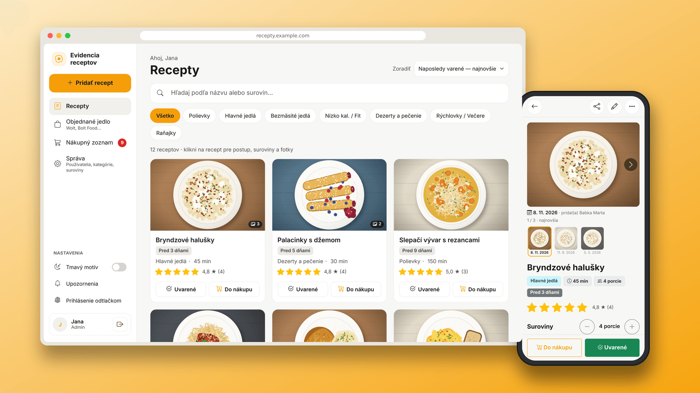
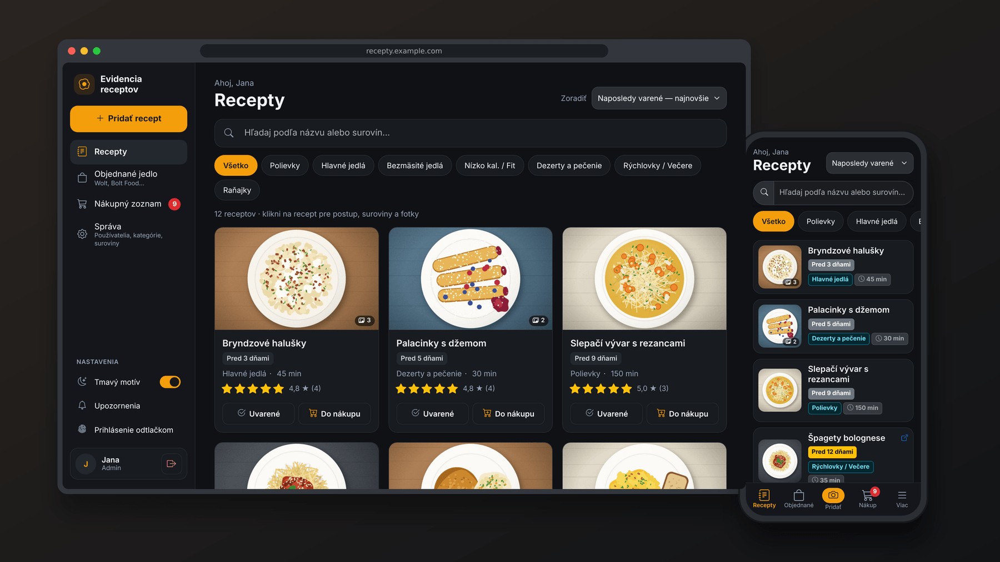

# Evidencia receptov

Rodinná webová appka na recepty. Beží v prehliadači a dá sa pridať na plochu telefónu ako aplikácia (PWA). Je pre malú skupinu ľudí, ktorí si recepty spravujú spoločne, a má veľké ovládacie prvky, aby sa s ňou dobre pracovalo aj starším.



<details>
<summary>🌙 <b>Pozri si aj tmavý vzhľad</b> (klikni sem)</summary>
<br>

</details>

Videá, ako sa pridáva recept (z fotky cez AI aj ručne), a ďalšie ukážky z telefónu aj z počítača sú v priečinku [`ukazky/`](ukazky/).

## Čo appka vie

- **Recepty** s kategóriou, časom prípravy, porciami, postupom a **galériou fotiek** (každé varenie môže mať vlastnú fotku s dátumom).
- **Suroviny z číselníka.** Vyhľadávanie ignoruje veľké písmená a diakritiku, pri preklepe appka ponúkne „Nemysleli ste Paradajky?“.
- **Hľadanie receptov po slovensky.** Nezáleží na páde ani na diakritike: „kuraciu cigánsku“ nájde „Kuracia cigánska“, „gulášu“ nájde „Hovädzí guláš“. Keď nič nesedí presne, appka skúsi podobné názvy („rezne“ → „Vyprážaný rezeň“). Platí v hľadaní aj pre hlasového asistenta.
- **Výživové hodnoty na porciu** (kcal, bielkoviny, sacharidy, tuky, cukry, nasýtené tuky, vláknina, soľ) ako všeobecný odhad zo surovín. Hodnoty surovín doplní AI samo, admin ich môže opraviť. Pozri [Výživové hodnoty](#výživové-hodnoty).
- **Prepočet porcií** s prevodom jednotiek (2000 g → 2 kg, 0,5 PL → 1½ ČL).
- **Spoločný nákupný zoznam.** Zlúči suroviny z viacerých receptov, dá sa odškrtávať a poslať do Google Keep. Zmeny od ostatných sa ukážu do pár sekúnd a keď niekto niečo pridá, ostatným príde upozornenie.
- **Uvarené, hodnotenie a história.** Pri recepte je vidno, kedy sa naposledy varil, a po 90 dňoch appka pripomenie, že by sa hodil zopakovať.
- **Objednané jedlo** (Wolt, Bolt Food, Bistro.sk a iné) zvlášť od receptov: kedy sme naposledy mali objednané jedlo, z akej reštaurácie a čo to bolo. Ku každej objednávke sa dá pridať fotka a ohodnotiť ju hviezdičkami, klik na objednávku otvorí jej náhľad (ako pri recepte). Hľadanie, filter podľa služby, objednávky po mesiacoch so súčtom cien. Samostatná stránka na celú obrazovku: na PC v bočnej ponuke pod Receptami, na telefóne v spodnej lište.
- **Upozornenia do telefónu** na nový recept, novú objednávku jedla, nové hodnotenie, pridanie do nákupu a dlho nevarené recepty.
- **Prihlásenie** heslom alebo odtlačkom prsta či Face ID, s možnosťou zostať prihlásený 90 dní.
- **Recepty bez internetu** (len na čítanie).
- **Recept z fotky.** AI (Gemini, Claude alebo OpenAI) z fotky jedla alebo kuchárky navrhne celý recept, ty ho skontroluješ a uložíš. Nepovinné.
- **Hlasový asistent v appke.** Ťukneš na mikrofón (vo vyhľadávaní, na PC v bočnej ponuke) a povieš, čo potrebuješ: „čo treba kúpiť?", „kedy sme naposledy robili guláš?", „navrhni recept na bábovku a ulož ho". Odpoveď prečíta telefón svojím slovenským hlasom. Používa ten istý kľúč k AI ako recept z fotky, nikto si nemusí zakladať žiadny účet. Pozri [Hlasový asistent](#hlasový-asistent).
- **Kuchárky v PDF.** Admin nahrá kuchárky v PDF (v Správe alebo cez FTP do priečinka `kucharky/`), appka z nich vytiahne text a hlasový asistent aj Claude v nich hľadajú, čo by sa dalo uvariť, aj s názvom knihy a stranou. Pozri [Kuchárky v PDF](#kuchárky-v-pdf).
- **AI asistent (Claude).** Appka sa dá pripojiť k asistentovi Claude. Potom mu stačí napísať alebo povedať, nech recept nájde a uloží do appky, zapíše varenie alebo pridá suroviny do nákupu. Každý si v nastaveniach vytvorí vlastnú adresu a všetko sa zapisuje pod jeho menom. Nepovinné, pozri [AI asistent](#ai-asistent-claude).
- **Rozloženie pre telefón** (spodná lišta Recepty, Objednané, Pridať, Nákup, Viac, formulár v troch krokoch) a **pre PC** (bočná ponuka), svetlý a tmavý vzhľad. Rýchle dvojité ťuknutie stránku na telefóne nepriblíži, zväčšiť sa dá dvoma prstami.
- **Správa** používateľov, kategórií a surovín pre admina, v rovnakom vzhľade ako zvyšok appky (na PC bočná ponuka, na telefóne spodná lišta).

## Požiadavky

| | |
|---|---|
| Server | Apache s povoleným `.htaccess` (pri nginx pozri [nižšie](#nginx)) |
| PHP | 8.4.1 alebo novšie, rozšírenia `pdo_mysql`, `openssl`, `curl`, `mbstring`, `gd` |
| Databáza | MariaDB 10.5 alebo novšia |
| Composer | Na stiahnutie knižníc do `vendor/`. Stačí ho mať na vlastnom počítači. |
| HTTPS | Potrebné pre pridanie na plochu, upozornenia a biometriu |

Node.js ani žiadne zostavovanie netreba, súbory sa nahrávajú tak, ako sú.

> **Prečo ešte Composer:** upozornenia už žiadnu knižnicu nepotrebujú, posiela ich vlastný kód v `includes/webpush.php`. Biometria (`webauthn/`) však stojí na knižnici `web-auth/webauthn-lib` a `includes/functions.php` načítava `vendor/autoload.php` na každej stránke. Bez `vendor/` appka nebeží vôbec.

## Inštalácia na webhosting

1. **Knižnice.** V priečinku projektu spusti `composer install --no-dev`. Vznikne priečinok `vendor/`.
2. **Súbory.** Nahraj celý projekt aj s `vendor/` na server, napríklad cez FTP. Appka funguje v koreni domény aj v podpriečinku. Do priečinka `uploads/` musí PHP vedieť zapisovať (práva 755 alebo 775). Fotky receptov idú do `uploads/recipes/`, fotky objednaného jedla do `uploads/objfood/` (ten si appka vytvorí sama pri prvej fotke).
3. **Databáza.** V administrácii hostingu vytvor databázu a používateľa s heslom. V phpMyAdmin klikni na **Import** a nahraj `sql/instalacia.sql`.
4. **Sprievodca.** Otvor `https://tvoja-domena/install.php`. Skontroluje server, pripraví obsah súboru `includes/.env` aj s kľúčmi (ulož ho, doplň údaje k databáze a obnov stránku) a vytvorí prvého admina.
5. **Upratanie.** Zmaž `install.php` zo servera a v administrácii hostingu zapni HTTPS (Let's Encrypt býva zadarmo).
6. **Cron (nepovinné).** Pripomienka „dlho ste nevarili" sa pošle pri prvom otvorení appky v daný deň medzi 9:00 a 20:00. Ak má chodiť aj vtedy, keď appku nikto neotvorí, nastav denné volanie `https://tvoja-domena/cron.php?key=HODNOTA_CRON_KEY`.

Verejná registrácia neexistuje, účty vytvára admin v **Správe**. Upozornenia a prihlásenie odtlačkom si každý zapne v appke sám. Na iPhone fungujú upozornenia len v appke pridanej na plochu (iOS 16.4 a novší).

**Kontrola na záver:** adresa `https://tvoja-domena/includes/.env` musí vrátiť chybu 403 alebo 404 a prihlásenie aj pridanie receptu s fotkou musí fungovať.

### Lokálne spustenie

```
composer install --no-dev
mysql -u root -p -e "CREATE DATABASE recepty CHARACTER SET utf8mb4 COLLATE utf8mb4_general_ci; CREATE USER 'recepty'@'localhost' IDENTIFIED BY 'zvol-si-heslo'; GRANT ALL ON recepty.* TO 'recepty'@'localhost';"
mysql -u recepty -p recepty < sql/instalacia.sql
php -S localhost:8000
```

Potom otvor `http://localhost:8000/install.php` a do `.env` daj `APP_HOST=localhost`. Heslo k databáze nesmie byť prázdne, takže účet `root` bez hesla z XAMPP-u appka neprijme.

- Vstavaný server PHP nepozná `.htaccess` a vydal by aj `includes/.env`. Používaj ho len na `localhost`, nikdy ho nesprístupňuj do siete.
- Na `localhost` funguje všetko okrem biometrie, tá potrebuje HTTPS na `APP_HOST`. Z iného zariadenia v domácej sieti bez HTTPS nefunguje ani plocha, offline režim a upozornenia.

### Docker (lokálne)

Najjednoduchšie spustenie na vlastnom počítači: netreba inštalovať PHP, MariaDB ani Composer, stačí [Docker Desktop](https://www.docker.com/products/docker-desktop/). Je to **len na skúšanie doma**, appka na serveri beží ďalej na webhostingu.

```
docker compose up --build
```

Prvé spustenie trvá pár minút (stiahne sa PHP 8.4 s Apache, MariaDB 10.11 a knižnice do `vendor/`). Keď sa vo výpise objaví `Appka je pripravená`, otvor **http://localhost:8080** a prihlás sa menom **admin** a heslom **recepty**. Databáza sa naplní sama zo `sql/instalacia.sql`, `install.php` netreba.

| Príkaz | Čo spraví |
|---|---|
| `docker compose up --build` | Spustí appku (Ctrl+C ju zastaví). S `-d` beží na pozadí. |
| `docker compose down` | Zastaví appku. Recepty v lokálnej databáze ostanú. |
| `docker compose down -v` | Zastaví appku a **zmaže** lokálnu databázu aj stiahnuté knižnice. |
| `docker compose logs -f app` | Výpis appky a chýb PHP. |
| `docker compose exec app bash testy/spusti-testy.sh` | [Testy](#testy) priamo v kontajneri (appka musí bežať). |
| `docker compose --profile db up` | Spustí aj Adminer na prehliadanie databázy: http://localhost:8081 (server `db`, používateľ `recepty`, heslo `recepty-lokalne-heslo`). |

- **Kód sa nekopíruje.** Priečinok projektu je pripojený do kontajnera, zmena v súbore je vidno po obnovení stránky. Pri CSS a JS si prehliadač drží starú verziu v cache service workera, kým sa nezvýši `CACHE_NAME` (alebo v nástrojoch prehliadača zaškrtni *Update on reload*).
- **Nová verzia z GitHubu:** po `git pull` stačí `docker compose up --build`. Pri štarte sa vždy spustí `sql/instalacia.sql` aj všetky migrácie (dajú sa spúšťať opakovane), takže lokálna databáza sa doplní sama, a keď sa zmení `composer.lock`, knižnice sa stiahnu znova.
- **Nastavenie** je v `docker-compose.yml` (databáza, `APP_HOST=localhost`, lokálne kľúče na upozornenia, `APP_DEBUG=1`). Heslá v ňom platia len pre tento počítač. Port `8080` sa dá zmeniť premennou `RECEPTY_PORT`.
- **AI** (recept z fotky, hlasový asistent): skopíruj `docker/.env.example` ako `docker/.env` a doplň kľúč. Ak máš v projekte aj `includes/.env`, appka si z neho vezme to, čo Docker nenastavuje (napr. AI kľúče), databázu a adresu však vždy prepíše Docker.
- **Fotky a kuchárky** sa ukladajú do `uploads/` a `kucharky/` v projekte, rovnako ako na serveri (na GitHub nejdú).
- Appka je dostupná len z tohto počítača (`127.0.0.1`). Biometria na `http://localhost` nefunguje, potrebuje HTTPS, všetko ostatné áno.
- **Claude Code:** v `.claude/launch.json` je nastavenie náhľadu — Claude Code spustí `docker compose up` a appku ukáže na porte 8080.
- Na server sa nič z toho nenahráva (`docker/`, `docker-compose.yml`, `.claude/` sú vylúčené v `nasadenie.yml`). Či Docker funguje, overuje `.github/workflows/docker.yml`.

### nginx

Appka chráni `includes/` a `sql/` súbormi `.htaccess`, ktoré pozná len Apache. Na nginx musíš prístup zakázať sám, inak si ktokoľvek stiahne `includes/.env` s heslami:

```nginx
location ^~ /includes/ { deny all; }
location ^~ /sql/      { deny all; }
location ^~ /vendor/   { deny all; }
```

## Nastavenie v `includes/.env`

Vzor je v `includes/.env.example`. Súbor obsahuje heslá, preto nepatrí na GitHub (je v `.gitignore`).

| Premenná | Význam |
|---|---|
| `DB_HOST`, `DB_NAME`, `DB_USER`, `DB_PASS` | Pripojenie k databáze. Heslo nesmie byť prázdne. `DB_CHARSET` je nepovinné (predvolene `utf8mb4`). |
| `APP_HOST` | Doména appky bez `https://` a bez lomky, napr. `recepty.example.com`. Potrebuje ju biometria. |
| `VAPID_PUBLIC_KEY`, `VAPID_PRIVATE_KEY` | Kľúče pre upozornenia, vygeneruje ich `install.php`. Nemeň ich, inak si všetci musia upozornenia povoliť znova. |
| `VAPID_SUBJECT` | Kontakt na správcu v tvare `mailto:meno@domena.sk`. |
| `CRON_KEY` | Tajný kľúč pre `cron.php`, aspoň 16 znakov. Prázdny = cron vypnutý. |
| `APP_DEBUG` | `1` zobrazí presnú chybu na obrazovke. V prevádzke nechaj `0`. |
| `GEMINI_API_KEY`, `ANTHROPIC_API_KEY`, `OPENAI_API_KEY`, `GROQ_API_KEY`, `MISTRAL_API_KEY` | Kľúče k AI (recept z fotky, hlasový asistent, výživa). Stačí jeden, bez kľúča sú tieto funkcie vypnuté. Gemini a Groq majú bezplatnú verziu, pozri [AI zadarmo](#ai-zadarmo-gemini--groq). Groq fotky nevie. |
| `AI_PORADIE` | V akom poradí služby skúšať, predvolene `gemini,groq,claude,openai,mistral`. Keď prvá zlyhá (minutý limit, výpadok), skúsi sa ďalšia. |
| `AI_DENNY_LIMIT` | Koľko fotiek môže jeden používateľ poslať za deň, predvolene `20` (`0` = bez limitu). |
| `AI_ASISTENT_MODEL_GEMINI`, `…_CLAUDE`, `…_OPENAI`, `…_MISTRAL`, `…_GROQ` | Iný model len pre hlasového asistenta (napr. rýchlejší `gemini-flash-lite-latest`). Prázdne = rovnaké ako pri fotke. |
| `AI_ASISTENT_DENNY_LIMIT` | Koľko otázok môže jeden používateľ položiť hlasovému asistentovi za deň, predvolene `100` (`0` = bez limitu). Počíta sa zvlášť od fotiek. |
| `AI_PREPIS_PORADIE` | Poradie služieb pri prepise hlasu z iPhonu, napr. `groq,gemini`. Prázdne = Groq prvý (ak má kľúč), potom `AI_PORADIE`. |
| `AI_PREPIS_MODEL_GROQ`, `…_GEMINI`, `…_MISTRAL`, `…_OPENAI` | Modely na prepis hlasu (viac oddelených čiarkou), aby prepis nemíňal limit modelu, ktorý odpovedá. Prázdne = Groq `whisper-large-v3,whisper-large-v3-turbo`, Gemini modely asistenta, Mistral `voxtral-mini-latest`, OpenAI `gpt-4o-mini-transcribe`. |
| `KUCHARKY_PRIECINOK` | Iný priečinok s kuchárkami v PDF (celá cesta na serveri). Prázdne = `kucharky/` v appke. |
| `AI_MODEL_GEMINI`, `…_CLAUDE`, `…_OPENAI`, `…_MISTRAL`, `…_GROQ` | Iné modely než predvolené, viac oddelených čiarkou (skúšajú sa po rade). Pri bezplatných verziách daj na prvé miesto model s najvyšším denným limitom. |

Premenné `AI_ADRESA_…` slúžia len na testy, v prevádzke ich nevypĺňaj.

### AI zadarmo (Gemini + Groq)

Gemini aj Groq majú bezplatnú verziu bez platobnej karty, obe s limitmi pre každý model zvlášť (Gemini denné, obnovia sa okolo 9:00 nášho času):

```
GEMINI_API_KEY=…          # aistudio.google.com/apikey
GROQ_API_KEY=…            # console.groq.com/keys
AI_PORADIE=gemini,groq
AI_MODEL_GEMINI=gemini-flash-lite-latest,gemini-3.8-flash   # model s vyšším denným limitom na prvom mieste
```

- **Prepis hlasu z iPhonu** robí Groq (Whisper, rozumie aj slovenčine) ako prvý — má vlastný denný limit, takže nemíňa limit Gemini. Keď ho minie, prepíše Gemini.
- **Asistent, výživa:** odpovedá Gemini, Groq až keď Gemini minie limit. Groq má v bezplatnom pláne malý limit tokenov za minútu, takže pri rýchlo položených otázkach môže odpovedať pomalšie alebo vôbec — je to záloha, nie hlavná služba.
- **Recept a nákup z fotky** Groq nevie, tie robí len Gemini (alebo Claude, OpenAI, Mistral).
- Keď majú limit minutý všetky služby, appka povie „Bezplatný limit AI je na dnes minutý…" namiesto všeobecnej chyby.

V bezplatných verziách môžu Google aj Groq používať poslané otázky, nahrávky a fotky podľa svojich podmienok; platené verzie sú prísnejšie. **Mistral** appka vie tiež (`MISTRAL_API_KEY`, aj prepis cez Voxtral), ale jeho API je od novembra 2026 len s predplateným kreditom. Za pár centov mesačne je spoľahlivejší aj Claude Haiku (`ANTHROPIC_API_KEY`).

## Hlasový asistent

Zapne sa sám, keď je v `.env` kľúč k aspoň jednej AI službe (tie isté ako pri recepte z fotky, v poradí `AI_PORADIE`). Databázu netreba meniť.

1. Mikrofón je vo vyhľadávaní receptov, v okne **Viac** a na PC v bočnej ponuke (**Hlasový asistent**). Na **Androide** (a v Chrome/Edge na PC) stačí podržať prst na ikone appky a vybrať **Hlasový asistent**; položku sa dá potiahnuť na plochu ako samostatnú ikonu. Otvorí appku rovno v asistentovi, mikrofón sa zapne ťuknutím (bez neho by telefón odpoveď nahlas neprečítal). iPhone takú ponuku pri webových appkách nemá.
2. Android a PC rozpoznajú reč priamo v prehliadači (slovenčina). **iPhone** nahrá zvuk a prepíše ho AI na serveri (Groq, Gemini, Mistral alebo OpenAI, Claude zvuk neprijíma) — rozpoznávanie v Safari totiž po prvom prečítaní odpovede nahlas zamrzne. Nahrávanie skončí samo po chvíli ticha (kto hovorí dlhšie, napr. diktuje recept, tomu znesie aj trojsekundovú pauzu), ťuknutím alebo po 2,5 minútach, mikrofón sa hneď uvoľní. Čítanie nahlas na iPhone stlmí mikrofón, preto sa pred nahrávaním zastaví a chvíľu sa počká; keď mikrofón aj tak nič nezachytí, nahrávka sa nepošle a appka povie, nech to skúsiš znova. Admin vidí pod každou nahrávkou jej dĺžku a hlasitosť a môže si ju vypočuť. Kde nejde ani jedno, appka ponúkne pole na písanie, do ktorého sa dá nadiktovať mikrofónom na klávesnici.
3. Otázka ide na server (`includes/asistent.php`). AI dostane tie isté nástroje ako asistent cez MCP (nájdi, zobraz, ulož recept, zapíš varenie, história receptu, čo sme varili, hodnotenie, nákup) a volá ich, kým nemá odpoveď. Hľadanie receptu nezáleží na páde („kedy sme robili kuraciu cigánsku?“), pri preklepe vráti podobný recept a asistent povie, že presne taký nie je. Rady a návrhy („čím nahradím smotanu?", „čo uvarím z…", „prečo mi spľasla piškóta?") a diktovanie receptu dostanú dlhšie premýšľanie modelu (Gemini a OpenAI `medium`, Groq `medium`), krátke príkazy idú rýchlo ako doteraz.
4. Odpoveď má dve časti: krátku prečíta telefón svojím hlasom a podrobnosti (celý recept, postup, zoznam varení) ukáže pod ňou na obrazovke. Ťuknutie na reproduktor prečíta aj podrobnosti. (iPhone nečíta v tichom režime; pri každej odpovedi je aj tlačidlo reproduktora). Na iPhone znie najlepšie **Laura (vylepšená)**: Nastavenia → Prístupnosť → Hovorený obsah → Hlasy → Slovenčina. Čítanie nahlas sa dá v okne vypnúť.

Keď poprosíš „ulož mi to do poznámok" (recept, nákup…), pri odpovedi sa ukáže tlačidlo **Uložiť do poznámok**. Otvorí zdieľanie telefónu, kde vyberieš Poznámky, Google Keep alebo správu; kde zdieľanie nejde (PC), text sa skopíruje. Keď sú v appke [kuchárky v PDF](#kuchárky-v-pdf), asistent v nich hľadá ako prvé a povie aj knihu a stranu. Recept z českej kuchárky povie aj zapíše po slovensky. Na „pridaj mi to do nákupu" pridá suroviny rovno do nákupu, recept kvôli tomu do appky neukladá.

**Nákup z fotky:** povedz „z fotky mi pridaj do nákupu" a pod odpoveďou sa ukážu tlačidlá **Odfotiť** a **Z galérie** (fotoaparát môže otvoriť len ťuknutie, sám od seba to telefón nedovolí). Na fotke môže byť recept z kuchárky alebo z obrazovky, nákupný zoznam na papieri alebo hotové jedlo. AI z nej vytiahne suroviny (český text preloží), pridajú sa do nákupu a ostatným príde upozornenie; recept sa neukladá. Počíta sa do denného limitu fotiek (`AI_DENNY_LIMIT`), ako recept z fotky.

**Kedy, kto, ako:** na „kedy sme robili kuraciu cigánsku?" asistent povie všetky dátumy (aj s dňom v týždni), kto varil, koľkokrát, ako ju kto ohodnotil a čo v nej je. Zvládne aj „čo sme varili minulý týždeň / v nedeľu / v októbri" a hodnotenie hlasom („daj tomu päť hviezdičiek"). Dátumy berie zo záznamov Uvarené v histórii receptu; varenie zapísané omylom a v recepte opravené na skorší dátum vynechá.

**Recept hlasom:** recept sa dá nadiktovať naraz alebo po častiach (názov, suroviny, postup, porcie, kedy sa varil). Asistent si ho skladá, na obrazovke ukazuje, čo už má, a pýta sa na to, čo chýba. Hotový recept ukáže celý na kontrolu a uloží ho až po „áno, ulož". Opravy („nie dve, ale tri vajcia") zapracuje. Na Androide končí rozpoznávanie reči pri prvej dlhšej pauze, preto je lepšie diktovať po častiach; asistent sa sám opýta na ďalšiu.

Všetko, čo asistent zapíše, je pod menom prihláseného používateľa, nový recept má v histórii „Pridané cez hlasového asistenta" a ostatným príde upozornenie (aj pri pridaní do nákupu). Rozhovor si pamätá posledných 12 správ, kým je okno otvorené. Keď služba zlyhá skôr, než asistent niečo zapísal, skúsi sa ďalšia v poradí.

## Kuchárky v PDF

Rodinné kuchárky v PDF sa dajú dať appke „prečítať". Potrebuje `sql/migracia-2.8.sql`, v `.env` nič netreba.

1. **Správa → Kuchárky** (len admin): vyber jedno alebo viac PDF a zvoľ **Nahrať**. Hneď sa spracujú, priebeh je vidno pri každej knihe. Väčšie súbory, než dovolí hosting (`upload_max_filesize`), nahraj cez FTP do priečinka `kucharky/` — v Správe sa ukážu ako nové a spracujú sa tlačidlom **Spracovať**, alebo samy cez `cron.php` (najviac 3 pri jednom spustení).
2. Appka vytiahne text každej strany (knižnica [smalot/pdfparser](https://github.com/smalot/pdfparser), pribalená v `includes/kniznice/pdfparser`) a uloží ho do databázy s fulltextovým indexom. Názov knihy vezme z PDF, inak zo súboru. Kniha s ~1000 stranami sa spracuje za pár desiatok sekúnd.
3. Hlasový asistent aj Claude dostanú nástroj `hladaj_v_kucharkach`: na otázku „čo uvariť z kuracích stehien?" nájdu najvhodnejšie strany a odporučia recept s knihou a stranou. Recept z knihy uložia do appky len na požiadanie.

PDF musí obsahovať text (dá sa v ňom označiť text). Naskenované kuchárky bez textu sa označia ako **Bez textu (sken)**. Priečinok `kucharky/` je z internetu zablokovaný (`.htaccess`), PDF nie sú na GitHube a nasadenie ich nenahráva ani nemaže. V Správe sa dá hľadanie vyskúšať, kniha prečítať znova (po výmene súboru) alebo zmazať aj so súborom.

## Výživové hodnoty

V náhľade receptu sú výživové hodnoty **na porciu** (pri recepte bez porcií za celý recept): energia, bielkoviny, sacharidy (z toho cukry), tuky (z toho nasýtené), vláknina a soľ. Je to **všeobecný odhad**, nie údaj z etikety. Potrebuje `sql/migracia-3.0.sql` a kľúč k AI v `.env` (ten istý ako pri recepte z fotky).

1. Každá surovina má v tabuľke `suroviny_vyziva` hodnoty na 100 g a údaje na prepočet: hustotu (koľko gramov má 1 ml — pre ml, l, lyžice a šálku), hmotnosť jedného kusu (ks, plátok, strúčik) a balenia. Štipka sa ráta ako 0,5 g.
2. Hodnoty odhadne AI — samo po uložení receptu (len pre jeho nové suroviny, až po odpovedi, takže ukladanie nečaká), cez `cron.php` (najviac 120 surovín) alebo tlačidlom **Doplniť chýbajúce cez AI** v Správe → Suroviny.
3. Appka z nich spočíta recept: množstvo × hodnota na 100 g, sčíta a vydelí porciami. Prepočet porcií v náhľade výživu na porciu nemení. Suroviny bez množstva („podľa chuti") alebo bez hodnôt sa nezarátajú a pod hodnotami je napísané, ktoré to sú.
4. V Správe → Suroviny je pri každej surovine **Výživové hodnoty**: hodnoty sa dajú opraviť (napr. podľa etikety). Ručne zadané hodnoty AI už neprepíše.

Hlasový asistent aj Claude dostanú výživu v nástroji `zobraz_recept`, takže odpovedia aj na „koľko kalórií má porcia guláša?". Bez migrácie 3.0 appka beží ďalej, len výživu neukazuje.

## AI asistent (Claude)

Appka má vstup pre AI asistentov cez **MCP** (Model Context Protocol): `mcp.php`. Asistent cez neho na pokyn používateľa, aj hlasom, robí to isté ako tlačidlá v appke. Nič netreba nastavovať v `.env`, stačí migrácia `sql/migracia-2.6.sql`.

**Pripojenie (každý člen rodiny zvlášť):**

1. V appke **Viac → Pripojiť k Claude** (na PC **Nastavenia → Pripojiť k Claude**) zvoľ **Vytvoriť adresu** a skopíruj ju. Appka ju ukáže len raz, v databáze je iba jej odtlačok.
2. V prehliadači otvor [claude.ai → Nastavenia → Konektory](https://claude.ai/settings/connectors), zvoľ **Pridať vlastný konektor**, názov `Recepty` a ako URL vlož adresu.
3. V mobilnej appke Claude sa konektor objaví sám. Bezplatná verzia Claude dovolí jeden vlastný konektor.

Asistent koná pod menom toho, komu adresa patrí: recept od neho má v histórii poznámku „Pridané cez AI asistenta“ a ostatným príde upozornenie ako pri bežnom pridaní. Adresa sa dá v tom istom okne kedykoľvek zrušiť, jeden používateľ môže mať najviac 5 adries. Zablokovaný používateľ sa cez adresu nepripojí.

| Nástroj | Čo robí |
|---|---|
| `najdi_recepty` | Hľadá podľa názvu, surovín alebo kategórie (bez ohľadu na diakritiku), aj „čo sme dlho nevarili". |
| `zobraz_recept` | Celý recept so surovinami a postupom. |
| `pridaj_recept` | Uloží nový recept. Suroviny napáruje na číselník (aj s iným poradím slov alebo preklepom), nové pridá. Rovnaký názov druhýkrát neuloží. |
| `zapis_varenie` | Ako tlačidlo Uvarené, aj so spätným dátumom. |
| `pridaj_do_nakupu`, `zobraz_nakup` | Suroviny receptu do nákupu (aj na iný počet porcií) a čo treba kúpiť. |
| `hladaj_v_kucharkach` | Hľadá v [kuchárkach v PDF](#kuchárky-v-pdf), vráti strany s textom, knihou a číslom strany. Len keď sú nejaké spracované. |

Funguje to s každým asistentom, ktorý vie pripojiť vlastný MCP server cez adresu. Stav k novembru 2026: Claude áno (aj zadarmo), ChatGPT dovolí zapisovať len vo firemných plánoch, Gemini má vlastné appky zatiaľ len v Spark mimo EÚ.

## Nová verzia na serveri

### Automaticky cez GitHub

Po vydaní verzie (Release) na GitHube spraví `.github/workflows/nasadenie.yml` toto:

1. spustí testy, a ak niečo zlyhá, nenahrá nič,
2. cez šifrované FTP nahrá len zmenené súbory a zmaže tie, ktoré v novej verzii už nie sú,
3. overí, že appka na serveri beží a že súbory s heslami nie sú dostupné z internetu.

Nikdy nenahrá ani nezmaže `includes/.env`, `vendor/`, `uploads/`, PDF v `kucharky/`, `sql/`, `install.php`, `testy/`, `ukazky/`, súbory pre Docker (`docker/`, `docker-compose.yml`, `.claude/`), `README.md`, `LICENSE` a `composer.json` / `composer.lock`. Release označený ako pre-release sa nenahráva. Súbor `includes/.ftp-deploy-sync-state.json` na serveri nemaž, podľa neho sa nahrávajú len zmeny.

**Jednorazové nastavenie:** v repozitári otvor **Settings → Secrets and variables → Actions** a pridaj:

| Secret | Hodnota |
|---|---|
| `FTP_SERVER`, `FTP_USERNAME`, `FTP_PASSWORD` | Prístup na FTP. Najlepšie samostatný FTP účet len na nahrávanie. |
| `FTP_DIR` | Priečinok appky s lomkou na konci, napr. `/recepty/`. Netreba, ak sa FTP účet prihlasuje rovno doň. |
| `APP_URL` | Adresa appky, napr. `https://recepty.example.com`. |

Nastavenie sa dá overiť cez **Actions → Nasadenie na server → Run workflow** so zaškrtnutým **Len skúška**: GitHub vypíše, čo by nahral, ale nič nezmení. Keď nahrávanie zlyhá, hlásenie v záložke **Actions** povie, ktorý Secret chýba alebo čo nesedí na FTP.

### Návrat k staršej verzii

**Actions → Nasadenie na server → Run workflow**, do poľa „verzia" napíš tag verzie, ktorá fungovala (napr. `V2.0.0`), a spusti. Databázu vracať netreba, lebo migrácie len pridávajú a staršia appka nové tabuľky ignoruje.

### Ručne cez FTP

1. Zálohuj databázu a priečinok `uploads/` (fotky receptov aj objednaného jedla).
2. Nahraj nové súbory cez staré. `includes/.env` a `uploads/` nechaj tak.
3. Ak verzia prináša `sql/migracia-X.Y.sql`, naimportuj ju v phpMyAdmin. Pri preskočení viacerých verzií naimportuj všetky chýbajúce od najstaršej.

Kým migrácia nie je naimportovaná, appka beží ďalej, len bez nových funkcií. Migráciu je bezpečné spustiť aj opakovane.

**Keď sa zmení `composer.lock`**, priečinok `vendor/` treba nahrať ručne (spusti `composer install --no-dev` a nahraj ho cez FTP). Automatické nahrávanie ho nerieši.

## Pre vývojára

### Technológie

PHP 8.4 bez frameworku, MariaDB cez PDO, čistý JavaScript bez zostavovania, Bootstrap 5.3 a Bootstrap Icons z CDN. Jediná knižnica cez Composer je `web-auth/webauthn-lib` na biometriu.

Všetky akcie (uloženie receptu, hodnotenie, nákup) idú ako POST na `index.php` s parametrom `action`, vracajú JSON a vyžadujú prihlásenie a CSRF token. Výnimka je `mcp.php` pre AI asistenta: prijíma správy JSON-RPC (MCP, Streamable HTTP bez stavu, verzie protokolu 2024-11-05 až 2025-11-25) a namiesto prihlásenia overí tajný kľúč z adresy (`?kluc=…`, prípadne `Authorization: Bearer`).

### Súbory

| Súbor alebo priečinok | Na čo slúži |
|---|---|
| `index.php` | Hlavná stránka so všetkými oknami a spracovanie všetkých akcií. |
| `login.php`, `logout.php` | Prihlásenie a odhlásenie. |
| `install.php` | Sprievodca prvou inštaláciou, potom sa maže. |
| `cron.php` | Denné pripomienky, spracovanie nových kuchárok v PDF a doplnenie výživových hodnôt surovín, chránené kľúčom `CRON_KEY`. |
| `mcp.php` | Vstup pre AI asistenta (MCP): overí kľúč z adresy a odpovie na správy JSON-RPC. Bez session a bez prihlásenia. |
| `script.js` | Logika hlavnej stránky v prehliadači, aj rozloženie pre telefón a PC. Stránky Recepty a Objednané jedlo (`index.php#objednane`) sa prepínajú bez načítania, tlačidlo Späť v prehliadači funguje. Adresa `index.php?otvor=pridat`, `nakup`, `viac` alebo `objednavky` otvorí príslušné okno (odkazy zo Správy). |
| `suroviny.js` | Výber surovín, kľúč suroviny, návrh pri preklepe a prepočet jednotiek. |
| `theme.js`, `webauthn-client.js`, `style.css` | Motív a prepnutie na HTTPS, biometria v prehliadači, štýly. |
| `sw.js`, `manifest.json`, `offline.html` | PWA: cache, kópia receptov na čítanie bez internetu, príjem upozornení. |
| `admin/` | Správa: používatelia (`index.php`), kategórie receptov (`kategorie.php`), suroviny (`suroviny.php`) a kuchárky v PDF (`kucharky.php`). `prevod-surovin.php` je jednorazový prevod zo starej verzie. |
| `includes/config.php`, `env.php` | Session, zápis chýb, načítanie `.env`, pripojenie k databáze. |
| `includes/auth.php` | Prihlásenie, „Zostať prihlásený", brzda proti hádaniu hesla. |
| `includes/functions.php` | Recepty, suroviny, porcie, nákup, fotky, hodnotenia, upozornenia, hľadanie so skloňovaním (`hladanie_zhoda`, rovnaké pravidlá má hľadanie v `script.js`). |
| `includes/webpush.php` | Odosielanie upozornení (šifrovanie a podpis cez openssl a curl). |
| `includes/objednavky.php` | Objednané jedlo: načítanie, kontrola a uloženie objednávok aj s fotkou, kto ich môže zmazať. |
| `includes/ai.php` | Recept z fotky: volanie AI služieb, kontrola odpovede, párovanie surovín, denný limit. |
| `includes/asistent.php` | Hlasový asistent: rozhovor s AI (Gemini, Claude, OpenAI) s volaním nástrojov appky, prepis nahrávky z iPhonu, text do poznámok, nákup z fotky, denný limit. |
| `includes/vyziva.php` | Výživové hodnoty: prepočet dávok na gramy, výpočet receptu na porciu, odhad hodnôt surovín cez AI, uloženie a kontrola. |
| `includes/kucharky.php` | Kuchárky v PDF: nahratie, čítanie textu po stranách, fulltextové hľadanie. |
| `includes/kniznice/pdfparser/` | Pribalená knižnica smalot/pdfparser 2.13.1 (LGPL-3.0) na čítanie PDF, bez Composera. |
| `kucharky/` | PDF kuchárky (nie sú na GitHube, z internetu zablokované). |
| `includes/mcp.php` | AI asistent: adresy (vytvorenie, overenie, zrušenie), popis nástrojov pre asistenta a ich vykonanie nad funkciami appky. |
| `includes/sprava.php` | Spoločné rozloženie stránok Správy: bočná ponuka na PC, tlačidlá častí a spodná lišta na telefóne. |
| `webauthn/` | Serverová časť biometrie. |
| `sql/` | `instalacia.sql` pre novú inštaláciu a `migracia-X.Y.sql` pre aktualizácie. |
| `uploads/recipes/`, `uploads/objfood/` | Fotky receptov a fotky objednaného jedla. |
| `testy/`, `.github/workflows/` | Automatické testy a nahrávanie na server. `testy/falosna-ai.php` je falošná AI služba pre test hlasového asistenta, `testy/hladanie.php` test hľadania so skloňovaním a textu upozornenia na nákup, `testy/vyziva.php` test výživových hodnôt. |
| `docker/`, `docker-compose.yml` | [Lokálne spustenie v Dockeri](#docker-lokálne): obraz PHP 8.4 s Apache (`docker/Dockerfile`), príprava pri štarte (`docker/entrypoint.sh`: knižnice, databáza, lokálny admin), nastavenie PHP a Apache. `.claude/launch.json` je náhľad pre Claude Code. Na server sa nenahrávajú. |
| `ukazky/` | Ukážkové fotky appky: náhľad v tomto README a galéria v `ukazky/README.md`. Na server sa nenahrávajú. |

### Databáza

Celá štruktúra s komentármi je v `sql/instalacia.sql`.

| Oblasť | Tabuľky |
|---|---|
| Účty | `users`, `login_attempts`, `auth_tokens` (Zostať prihlásený), `webauthn_credentials`, `push_subscriptions` |
| Recepty | `recipes`, `recipe_logs` (história), `recipe_ratings`, `recipe_photos` (galéria), `kategorie_receptov` |
| Suroviny a nákup | `suroviny`, `suroviny_vyziva` (výživové hodnoty na 100 g), `recept_suroviny`, `recept_suroviny_zaloha`, `nakupny_zoznam` |
| Recept z fotky | `ai_rozpoznania` (denný limit) |
| Objednané jedlo | `objednane_jedla` (Wolt, Bolt Food…, s receptami nesúvisí), `objednavky_hodnotenia` |
| AI asistent | `ai_pripojenia` (adresy pre Claude a iných, len odtlačky kľúčov) |
| Kuchárky v PDF | `kucharky` (súbory a stav spracovania), `kucharky_strany` (text strán s fulltextovým indexom) |

| Migrácia | Čo pridá |
|---|---|
| `migracia-1.1.sql` | Tabuľku `recipe_photos` a prenesie do nej doterajšie fotky. |
| `migracia-1.5.sql` | Tabuľku `kategorie_receptov` s doterajšími siedmimi kategóriami. |
| `migracia-1.8.sql` | Tabuľku `ai_rozpoznania`. |
| `migracia-2.2.sql` | Tabuľku `objednane_jedla`. |
| `migracia-2.4.sql` | Stĺpec `foto` v `objednane_jedla` (fotka objednávky). |
| `migracia-2.5.sql` | Tabuľku `objednavky_hodnotenia` (hodnotenie objednávok hviezdičkami). |
| `migracia-2.6.sql` | Tabuľku `ai_pripojenia` (AI asistent cez MCP). |
| `migracia-2.8.sql` | Tabuľky `kucharky` a `kucharky_strany` (kuchárky v PDF). |
| `migracia-3.0.sql` | Tabuľku `suroviny_vyziva` (výživové hodnoty surovín). |

### Pravidlá pre novú verziu

- Zmeny databázy patria do `sql/migracia-X.Y.sql` a zároveň do `sql/instalacia.sql`. Migrácia musí ísť spustiť opakovane bez zdvojenia dát.
- Appka musí bežať aj bez migrácie, s kontrolou existencie tabuľky (napr. `recipes_have_photos()`).
- Migrácie len pridávajú. Tabuľku ani stĺpec nemaž ani nepremenúvaj v tej istej verzii, inak by návrat k staršej verzii nestačil.
- Po zmene CSS, JS alebo `offline.html` zvýš `CACHE_NAME` v `sw.js` a číslo za `?v=` v `index.php` a `login.php`.
- Knižnice z CDN v `index.php` musia byť aj v `CDN_ASSETS` v `sw.js`, pri ikonách aj písmo `bootstrap-icons.woff2`.
- Kľúč suroviny (malé písmená, bez diakritiky) sa počíta na troch miestach a musí vyjsť rovnako: `surovina_key()` vo `functions.php`, `normKey()` v `suroviny.js` a stĺpec `kluc` v `sql/instalacia.sql`.
- Každá verzia má riadok v [Histórii verzií](#história-verzií) v tvare `**X.Y**`.

Okrem pravidla o migráciách, ktoré len pridávajú, všetko ostatné skontrolujú testy.

### Testy

`testy/spusti-testy.sh` beží na GitHube pri každom nahratí do `main` a pred nahratím na server. Overí syntax PHP, pravidlá vyššie, novú inštaláciu, beh novej appky nad databázou predchádzajúcej verzie, migrácie a celý priechod appkou (`testy/smoke.php` sa prihlási, pridá a upraví recept, použije nákup, správu, pripojí sa ako AI asistent cez `mcp.php` a ďalšie) a hlasového asistenta s falošnou AI službou (`testy/falosna-ai.php`) pre Gemini, Claude aj OpenAI vrátane prepnutia na záložnú službu, a hľadanie so skloňovaním aj text upozornenia na nákup (`testy/hladanie.php`) a výživové hodnoty (`testy/vyziva.php`). Offline režim v prehliadači treba vyskúšať ručne.

Na vlastnom počítači (PHP 8.4.1+, bežiaca MariaDB, stiahnutý `vendor/`):

```
TEST_DB_ROOT_USER=root TEST_DB_ROOT_PASS=heslo bash testy/spusti-testy.sh
```

Test si založí vlastné databázy `recepty_test_…` a na konci ich zmaže. Tvoj `.env` ani fotky nemení. Na Windows sa dá spustiť cez Git Bash alebo WSL.

Bez vlastného PHP a MariaDB stačí [Docker](#docker-lokálne): `docker compose up -d` a potom `docker compose exec app bash testy/spusti-testy.sh`.

## Riešenie problémov

Chyby sa zapisujú do `includes/debug-log.txt`. S `APP_DEBUG=1` v `.env` sa presná chyba ukáže priamo na obrazovke.

| Príznak | Čo s tým |
|---|---|
| „Chýba povinná konfiguračná premenná…" | Doplň uvedený riadok do `includes/.env`. |
| „Aplikácia sa nevie pripojiť k databáze" | Skontroluj `DB_HOST`, `DB_NAME`, `DB_USER` a `DB_PASS`. |
| Biela stránka | Chýba `vendor/` alebo je na serveri PHP staršie než 8.4.1. |
| Fotka sa nenahrá | Do `uploads/recipes/` (pri objednanom jedle `uploads/objfood/`) sa nedá zapisovať alebo chýba rozšírenie `gd`. |
| Upozornenia nechodia | Používateľ ich nepovolil, appka nebeží na HTTPS, alebo je v logu `PUSH ZLYHAL`. Na iPhone len v appke z plochy. V **Správe → Používatelia** je pri každom vidno, na koľkých zariadeniach ich má zapnuté; kto ich má vypnuté, vidí v appke pásik so Zapnúť. Keď ich niekto v telefóne zablokoval, appka ich zapnúť nevie, musí ich povoliť v nastaveniach telefónu (pásik ukáže kde). |
| Biometria hlási chybu | `APP_HOST` nesedí s doménou alebo appka nebeží na HTTPS. |
| Pri novom recepte sa „Naposledy varené“ neuložilo | Safari na iPhone ukazuje v prázdnom dátumovom poli dnešný dátum, hoci v ňom nič nie je. Použi tlačidlo Dnes / Včera alebo v kalendári ťukni na deň; pod poľom je napísané, čo sa uloží. |
| Hlasový asistent nepočuje | Prehliadač nemá povolený mikrofón (na iPhone Nastavenia → Safari → Mikrofón). Vždy sa dá nadiktovať do poľa mikrofónom na klávesnici. |
| iPhone sa pýta na mikrofón stále znova | Appka na ploche (PWA) si na iPhone povolenie nepamätá medzi spusteniami — to je obmedzenie iOS. Kým je appka otvorená, pýta sa raz. V Safari pomôže Nastavenia → Safari → Mikrofón → Povoliť. |
| Na iPhone asistent hovorí „Mikrofón nič nezachytil“ alebo nerozumie | Mikrofón dával ticho (napr. hneď po čítaní nahlas). Ťukni znova; keď to nepomôže, zavri asistenta a otvor ho znova. Admin vidí pod nahrávkou hlasitosť a môže si ju vypočuť — keď je skoro nulová, ticho dáva iPhone. |
| Asistent hlási „Bezplatný limit AI je na dnes minutý" alebo admin vidí „minutý limit alebo kredit (429)" | Bezplatné verzie majú limit na každý model (Gemini sa obnoví okolo 9:00 nášho času). Pridaj ďalšiu bezplatnú službu Groq (`GROQ_API_KEY`, `AI_PORADIE=gemini,groq`), daj na prvé miesto model s vyšším limitom, alebo zapni platenie. |
| Upozornenie na nákup príde viackrát | Položky pridané jedným človekom za 15 minút sa zlúčia do jedného upozornenia, ktoré sa len obnoví. Suroviny receptu majú vlastné upozornenie pre každý recept. |
| Na iPhone asistent hlási, že prepis hlasu nejde | Prepis robí Groq, Gemini, Mistral alebo OpenAI: aspoň jedna z nich musí mať kľúč (Groq stačí mať v `.env`, ostatné aj v `AI_PORADIE`). Admin vidí pod chybou „Prepis zlyhal: …“ s dôvodom pri každom modeli (napr. 429 = minutý limit, 503 = preťažený); to isté je v `includes/debug-log.txt` pod `AI ASISTENT prepis`. |
| Kuchárka je „Bez textu (sken)" | PDF je naskenované, text v ňom nie je. Treba verziu s textom (alebo ju najprv prehnať cez OCR). |
| Kuchárka sa nespracuje (chyba alebo bez konca) | Pri veľkej knihe môže hosting prerušiť spracovanie po časovom limite PHP — skús **Prečítať znova** alebo nechaj cron. V `includes/debug-log.txt` hľadaj `KUCHÁRKY`. |
| Asistent odpovedá, ale nečíta nahlas | iPhone je v tichom režime (prepínač alebo tlačidlo Akcia) — Safari vtedy nečíta. Ťukni na reproduktor pri odpovedi. Skontroluj aj prepínač Čítať odpovede nahlas v okne asistenta. |
| Hlas asistenta znie zle alebo nie po slovensky | V telefóne chýba slovenský hlas: na iPhone stiahni Lauru (vylepšenú) v Nastavenia → Prístupnosť → Hovorený obsah → Hlasy. |
| Asistent odpovedá pomaly | Ako admin uvidíš pod odpoveďou, koľko trvali volania AI (bývajú dve: zistiť, čo treba, a odpovedať). Ak je pomalá AI, skús rýchlejší model v `AI_ASISTENT_MODEL_GEMINI` (napr. `gemini-flash-lite-latest`) alebo iné `AI_PORADIE`. |
| Asistent hlási, že neodpovedá | V `includes/debug-log.txt` hľadaj `AI ASISTENT` (zlý kľúč, minutý kredit, výpadok služby). |
| Claude sa nevie pripojiť ku konektoru | Adresa bola zrušená alebo zle skopírovaná (v appke vytvor novú), alebo nie je spustená `migracia-2.6.sql`. V `includes/debug-log.txt` hľadaj `AI ASISTENT`. |
| Recept nemá výživové hodnoty | Chýba migrácia `migracia-3.0.sql`, kľúč k AI, alebo suroviny ešte nemajú hodnoty (Správa → Suroviny → Doplniť chýbajúce cez AI). Recept musí mať suroviny vybrané zo zoznamu aj s množstvami; v `includes/debug-log.txt` hľadaj `VÝŽIVA`. |
| Po nahratí novej verzie starý vzhľad | V `sw.js` nebol zvýšený `CACHE_NAME`. |
| Bez internetu sa ukáže „Si offline" | Appka sa v zariadení ešte neotvorila s internetom po prihlásení. |
| V logu `FOTKY`, `KATEGÓRIE`, `SUROVINY`, `OBJEDNAVKY`… | V databáze chýba tabuľka, naimportuj migráciu. |

## Zálohovanie

Zálohovať treba databázu (export v phpMyAdmin), priečinok `uploads/` (recepty aj objednané jedlo) a súbor `includes/.env`. Všetko ostatné je na GitHube.

Pri prenose na iný server stačí tieto tri veci preniesť a v `.env` upraviť údaje k databáze a `APP_HOST`. Pri zmene domény si každý musí znova zapnúť prihlásenie odtlačkom.

## Licencia

Copyright (C) 2026 Marián Čambálik

Evidencia receptov je pod licenciou [GNU Affero General Public License, len verzia 3](LICENSE) (AGPL-3.0-only). Kód sa smie používať, upravovať a šíriť, ale kto upravenú verziu ponúka iným, aj len ako webovú stránku, musí jej zdrojový kód zverejniť pod rovnakou licenciou. Použitie za iných podmienok (napríklad bez zverejnenia úprav) sa dá dohodnúť s autorom.

Verzie do 3.2.1 vrátane boli vydané pod licenciou MIT a pre ne MIT platí ďalej.

## História verzií

- **3.3** Hlasový asistent ako skúsený kuchár. Na „kedy sme robili…" povie všetky varenia, kto varil, hodnotenia a suroviny (nové nástroje `historia_receptu`, `co_sme_varili`, `ohodnot_recept` — aj pre Claude cez MCP), zvládne „čo sme varili minulý týždeň" a hodnotenie hlasom. Recept sa dá nadiktovať po častiach, asistent ho ukáže na kontrolu a uloží až po súhlase; otázka môže mať do 4000 znakov a nahrávka z iPhonu do 2,5 minúty s dlhšou pauzou pri diktovaní. Odpoveď má krátku časť na čítanie nahlas a podrobnosti na obrazovke. Rady a návrhy dostanú dlhšie premýšľanie modelu. **Android:** podržanie ikony appky ponúkne skratky **Hlasový asistent** a **Nákupný zoznam**. **Upozornenia:** posielajú sa s vysokou prioritou (prídu hneď aj v úspornom režime), kto ich má vypnuté, uvidí v appke pásik s tlačidlom Zapnúť, a v Správe pri používateľoch je vidno, kto ich má zapnuté. Vypnuté upozornenia v telefóne appka obísť nemôže. **Licencia:** od tejto verzie [AGPL-3.0](#licencia) namiesto MIT, staršie verzie ostávajú pod MIT. **Docker na lokálne spustenie:** `docker compose up --build` spustí appku na http://localhost:8080 s PHP 8.4, Apache a MariaDB 10.11, databáza sa pripraví sama a prihlásiť sa dá ako admin / recepty ([návod](#docker-lokálne)), s náhľadom pre Claude Code (`.claude/launch.json`) a testom Dockeru na GitHube (`docker.yml`). Na server sa z toho nič nenahráva. Databáza sa nemení.
- **3.2.1** Nákupný zoznam: menu **Vymazať** (Len kúpené / Celý zoznam) sa na telefóne otváralo smerom dole a schovalo sa pod spodnú lištu. Teraz sa otvára nahor a položky sú väčšie na ťuknutie. Databáza sa nemení.
- **3.2** Ďalšie AI služby, aby appka nezávisela len od limitu Gemini. **Groq** (`GROQ_API_KEY`, bezplatný plán bez karty): prepis hlasu z iPhonu cez Whisper ako prvá voľba (vlastný denný limit, nemíňa Gemini) a asistent aj výživa ako záloha; fotky Groq nevie a preskočí sa. **Mistral** (`MISTRAL_API_KEY`, API s kreditom): asistent, prepis cez Voxtral, fotky aj výživa. Poradie a modely na prepis: `AI_PREPIS_PORADIE`, `AI_PREPIS_MODEL_GROQ` / `_GEMINI` / `_MISTRAL`. Keď majú minutý limit všetky služby, appka povie „Bezplatný limit AI je na dnes minutý…" namiesto všeobecnej chyby. Databáza sa nemení.
- **3.1** Nákup z fotky v hlasovom asistentovi: na „z fotky mi pridaj do nákupu" sa ukážu tlačidlá Odfotiť a Z galérie, AI z fotky (recept, kuchárka, nákupný zoznam, jedlo, aj po česky) vytiahne suroviny a pridá ich do nákupu bez uloženia receptu, ostatným príde upozornenie. Počíta sa do denného limitu fotiek. Databáza sa nemení.
- **3.0** Výživové hodnoty: v náhľade receptu sú kcal, bielkoviny, sacharidy, tuky, cukry, nasýtené tuky, vláknina a soľ na porciu ako všeobecný odhad zo surovín. Hodnoty surovín na 100 g (aj hustota, hmotnosť kusu a balenia na prepočet ml, lyžíc a kusov) doplní AI samo po uložení receptu, cronom alebo tlačidlom v Správe → Suroviny, kde sa dajú aj ručne opraviť. Asistent aj Claude vedia povedať, koľko kalórií či bielkovín má porcia. Migrácia `migracia-3.0.sql`.
- **2.9.3** Nákup z kuchárky bez uloženia receptu: keď asistent (v appke aj Claude) pridáva do nákupu suroviny receptu, ktorý v appke nie je (z kuchárky, z webu, vlastný návrh, alebo len „pridaj mlieko a chlieb"), pridá ich rovno do nákupu — recept neuloží a ostatným príde len upozornenie na nákup („… pridal(a) do nákupu suroviny na „Zemiakové placky""). Suroviny sa napárujú na zoznam appky a zlúčia s rovnakými v nákupe. Recepty z českých kuchárok asistent vždy prekladá do slovenčiny (názov, suroviny aj postup) a v kuchárkach hľadá slovensky aj česky. Databáza sa nemení.
- **2.9.2** Hlasový asistent nezapisuje z nejasnej reči: skomolený prepis („robili koracu cigánsko") zapísal varenie. Asistent teraz zapisuje (varenie, nákup, recept) len na jasný pokyn, pri otázke „kedy sme robili…" len hľadá a pri nezrozumiteľnej vete sa opýta. Keď po zápise zlyhá, povie presne, čo zapísal. Prepis nahrávky dostane názvy receptov z appky, aby ich AI napísala správne (Gemini aj OpenAI). Databáza sa nemení.
- **2.9.1** Prepis hlasu z iPhonu: keď prvý model Gemini nahrávku neprepíše (preťažený, minutý limit, prázdna odpoveď), skúsia sa ďalšie modely z `AI_ASISTENT_MODEL_GEMINI` (inak `AI_MODEL_GEMINI`), potom ďalšia služba v poradí. Keď prepis aj tak zlyhá, admin vidí v okne asistenta presný dôvod pri každom modeli (aj keď zlyhá samotný asistent). Databáza sa nemení.
- **2.9** Hľadanie po slovensky: nezáleží na páde („kuraciu cigánsku“ nájde „Kuracia cigánska“), keď nič nesedí presne, skúsia sa podobné názvy („rezne“ → „Vyprážaný rezeň“). Platí vo vyhľadávaní receptov aj pre hlasového asistenta a Claude (asistent povie, keď je to len podobný recept). **Upozornenie na nákup:** keď niekto pridá položku alebo suroviny receptu (aj cez asistenta), ostatným príde upozornenie, ťuknutie otvorí nákup. Položky pridané za sebou sa zlúčia do jedného upozornenia, upozornenia sa odosielajú až po odpovedi, takže pridávanie nečaká. **Hlas na iPhone:** nahrávalo sa ticho a AI z neho „prepísala" len „..." — tiché odomknutie čítania nahlas tesne pred zapnutím mikrofónu mikrofón stlmilo. Hlas sa teraz odomyká pri otvorení asistenta, pred nahrávaním sa počká na koniec čítania, meranie hlasitosti na iPhone naozaj beží (nahrávka sa sama ukončí po tichu), tichá nahrávka sa neposiela a prepis z bodiek alebo „[ticho]“ sa berie ako nič. Admin vidí pod nahrávkou jej dĺžku a hlasitosť a môže si ju vypočuť. Databáza sa nemení.
- **2.8** Hlasový asistent na iPhone už netreba po každej otázke reštartovať: iPhone zvuk nahrá a prepíše ho AI na serveri (Gemini alebo OpenAI), nahrávanie skončí samo po chvíli ticha a mikrofón sa hneď uvoľní. Asistent vie pripraviť text na uloženie — tlačidlo **Uložiť do poznámok** otvorí zdieľanie (Poznámky, Google Keep), na PC text skopíruje. **Kuchárky v PDF:** v Správe (alebo cez FTP do `kucharky/`) sa nahrajú kuchárky, appka vytiahne text strán a asistent aj Claude v nich hľadajú, čo uvariť, aj s knihou a stranou. Migrácia `migracia-2.8.sql`.
- **2.7.3** Hlasový asistent rýchlejšie: model premýšľa čo najkratšie (Gemini a OpenAI najprv „minimal"), na pomalý alebo preťažený model sa pred záložným pokusom čaká najviac 25 sekúnd namiesto 45, pre asistenta sa dá nastaviť rýchlejší model (`AI_ASISTENT_MODEL_…`). Počas čakania okno ukazuje ubehnuté sekundy, admin vidí pod odpoveďou rozpis času (volania AI, nástroje) a zapisuje sa aj do `includes/debug-log.txt`. Databáza sa nemení.
- **2.7.2** Hlasový asistent na iPhone: odpoveď sa nečítala nahlas sama. Safari zahodí čítanie spustené hneď po zastavení predošlého a appka si tým rušila aj „odomknutie" čítania z ťuknutia — teraz sa zastavuje len to, čo naozaj hovorí, a po zastavení sa chvíľu počká. Pri každej odpovedi je tlačidlo reproduktora (prečíta ju aj pri vypnutom čítaní nahlas) a keď telefón čítanie aj tak nepustí, appka poradí, čo skontrolovať. Databáza sa nemení.
- **2.7.1** Oprava automatického testu: časť „databáza predchádzajúcej verzie bez migrácie" pre pripojenie k Claude sa riadi tým, či tá databáza tabuľku `ai_pripojenia` už má (po vydaní 2.6 ju má). Appka sa nemení, databáza tiež nie.
- **2.7** Hlasový asistent priamo v appke: mikrofón vo vyhľadávaní (na PC aj v bočnej ponuke, na telefóne aj vo Viac). Reč rozpozná telefón, AI zo `.env` (Gemini, Claude alebo OpenAI) použije nástroje appky (nájdi, ulož recept, uvarené, nákup) a odpoveď prečíta telefón svojím slovenským hlasom. Kde rozpoznanie reči nejde, ostáva písanie s diktovaním z klávesnice. Denný limit `AI_ASISTENT_DENNY_LIMIT` (predvolene 100) sa počíta zvlášť od fotiek. Pripojenie cez MCP sa v nastaveniach volá „Pripojiť k Claude". Databáza sa nemení.
- **2.6** AI asistent: appka sa dá pripojiť k Claude cez MCP (`mcp.php`). Asistent na pokyn, aj hlasom, nájde a zobrazí recept, uloží nový recept (suroviny napáruje na číselník, rovnaký názov druhýkrát neuloží), zapíše varenie a pridá suroviny do nákupu. Každý používateľ si vo Viac / Nastaveniach vytvorí vlastnú adresu (ukáže sa len raz, v databáze je odtlačok) a môže ju zrušiť, všetko sa zapisuje pod jeho menom a ostatným príde upozornenie. Migrácia `migracia-2.6.sql`.
- **2.5.2** Šípka hore: keď sa stránka (recepty aj Objednané jedlo) posunie aspoň o obrazovku nižšie, vpravo dole sa ukáže okrúhle tlačidlo so šípkou, ktoré vráti na začiatok. Na telefóne je nad spodnou lištou, na PC v pravom dolnom rohu. Databáza sa nemení.
- **2.5.1** Oprava „Naposledy varené“ pri pridávaní receptu: na iPhone sa dátum často neuložil (Safari ukazuje v prázdnom poli dnešný dátum, hoci v ňom nič nie je), a tak bol nový recept „ešte nevarený“. Pod poľom pribudli veľké tlačidlá Dnes, Včera a vymazať a text, čo sa naozaj uloží. Najvyšší dátum (dnes) sa nastaví pri každom otvorení formulára, aby appka otvorená v telefóne niekoľko dní neodmietla dnešný dátum. Databáza sa nemení.
- **2.5** Objednané jedlo: klik na objednávku otvorí náhľad ako pri recepte (fotka, údaje, čo sme mali), upraviť a zmazať sa dá z neho. Hodnotenie hviezdičkami (každý jedno, priemer v zozname aj v náhľade). Upozornenie ostatným pri novej objednávke a autorovi pri hodnotení, ťuknutie otvorí náhľad objednávky (aj cez prihlásenie). Migrácia `migracia-2.5.sql`.
- **2.4** Fotka pri objednanom jedle: vo formulári Odfotiť alebo Z galérie (na PC Vybrať fotku), v zozname miniatúra, pri Naposledy objednané fotka poslednej objednávky. Fotky sa ukladajú do `uploads/objfood/` a spracujú sa rovnako ako fotky receptov (zmenšenie, JPEG). Pri novej fotke, odstránení alebo zmazaní objednávky sa starý súbor zmaže. Migrácia `migracia-2.4.sql`.
- **2.3.1** Objednané jedlo: namiesto foodora je na výber Bistro.sk (červený krúžok „Bi“). Staršie záznamy z foodora sa ukazujú ako Iné. Databáza sa nemení.
- **2.3** Objednané jedlo je samostatná stránka na celú obrazovku namiesto okna, aj formulár na pridanie a úpravu. Spodná lišta na telefóne: Recepty, Objednané, Pridať (v strede), Nákup, Viac. Tlačidlo Späť v telefóne vráti z formulára na zoznam a zo zoznamu na recepty. Databáza sa nemení.
- **2.2** Objednané jedlo: zvlášť od receptov sa dá zapísať jedlo z Wolt, Bolt Food, foodora a podobne (kedy, odkiaľ, reštaurácia, čo sme mali, nepovinne cena). Hore je vidno, kedy sme naposledy objednávali a čo, zoznam sa dá prehľadávať a filtrovať podľa služby a pozrieť aj bez internetu. Na PC v bočnej ponuke pod Receptami, na telefóne v okne Viac. Zapísať a upraviť môže každý, zmazať ten, kto objednávku zapísal, alebo admin. Migrácia `migracia-2.2.sql`.
- **2.1** Správa v rovnakom vzhľade ako appka: na PC bočná ponuka s časťami Správy, na telefóne veľké tlačidlá častí a spodná lišta. Kategórie receptov majú vlastnú stránku, nové heslo sa zadáva priamo pri používateľovi. Databáza sa nemení.
- **2.0.2** Rýchle dvojité ťuknutie (napr. pri pridávaní receptu) už na telefóne nepriblíži stránku. Priblíženie dvoma prstami ostáva.
- **2.0.1** Obsah na PC sa roztiahne na celú šírku obrazovky, na veľkom monitore je viac stĺpcov kariet.
- **2.0** Nové rozloženie na PC: bočná ponuka, veľké hľadanie, kategórie ako tlačidlá, karty s tlačidlami Uvarené a Do nákupu, náhľad receptu s fotkami vľavo a receptom vpravo.
- **1.9** Formulár receptu na telefóne v troch krokoch (Základ, Suroviny, Postup a fotka). Recept z fotky ide rovno do vyplneného formulára.
- **1.8.2** Keď je Gemini preťažený, appka skúsi záložný ľahší model. V `AI_MODEL_…` môže byť viac modelov.
- **1.8.1** Oprava: rozpoznanie cez Gemini nestihlo odpovedať, AI teraz premýšľa krátko.
- **1.8** Recept z fotky cez AI (Gemini, Claude, OpenAI) s denným limitom. Migrácia `migracia-1.8.sql`.
- **1.7** Nové rozloženie pre telefón: spodná lišta Recepty, Pridať, Nákup, Viac a okná na celú obrazovku s veľkými tlačidlami.
- **1.6** Správa surovín (kategória, premenovanie, zlúčenie, zmazanie) a návrh „Nemysleli ste …?" pri preklepe.
- **1.5** Prepočet porcií prevádza jednotky (2000 g → 2 kg). Kategórie receptov spravuje admin. Migrácia `migracia-1.5.sql`.
- **1.4** Nákupný zoznam sa sám obnovuje každých 5 sekúnd.
- **1.3** Recepty sa dajú pozerať aj bez internetu.
- **1.2** Automatické testy a automatické nahrávanie na server po vydaní verzie, návrat k staršej verzii jedným klikom.
- **1.1** Galéria fotiek receptu a okno Uvarené s dátumom. Migrácia `migracia-1.1.sql`.
- **1.0** Prvá zverejnená verzia.
